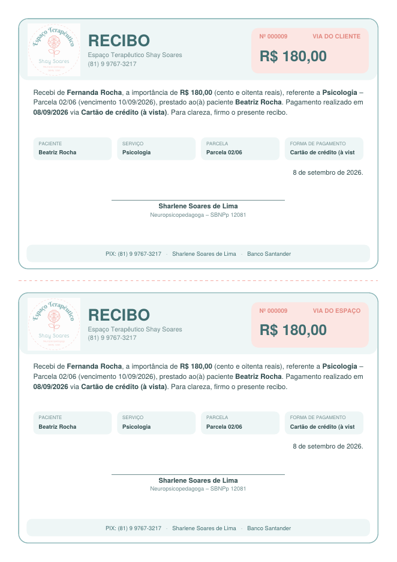
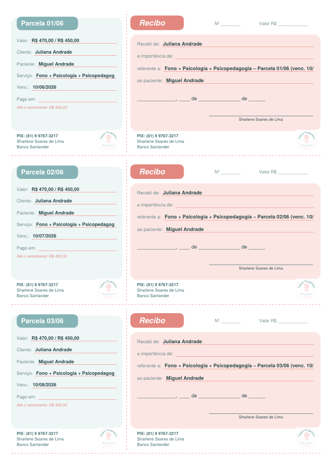
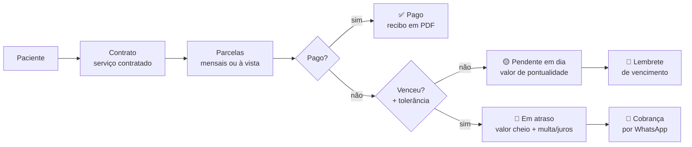
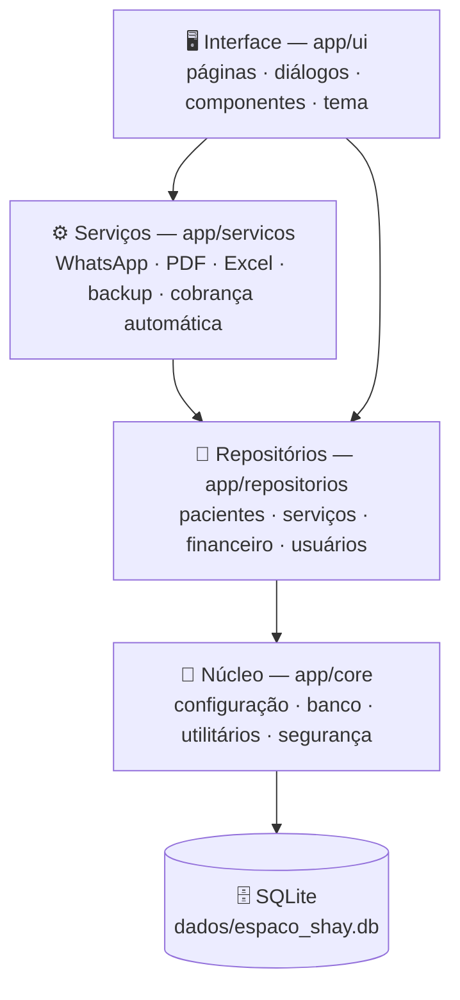
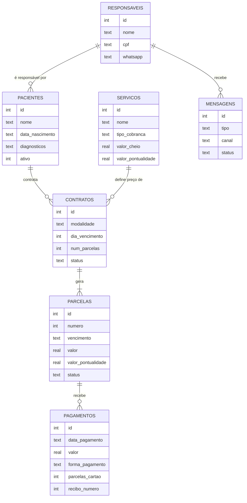

<p align="center">
  
</p>

<p align="center">
  
  
  
  
  
  
</p>

<p align="center">
  Sistema <b>desktop</b> para clínicas multidisciplinares que atendem crianças, adolescentes e adultos com
  <b>TEA, TDAH</b> e outras condições — psicologia, psicopedagogia, fonoaudiologia, terapia ABA e avaliações.<br>
  Cadastro completo, controle financeiro, recibos e carnês em PDF e cobrança por WhatsApp.
  Roda no computador, com banco de dados local.
</p>

---

## Sumário

- [Funcionalidades](#funcionalidades)
- [Documentos gerados](#documentos-gerados)
- [Instalação](#instalação)
- [Primeiros passos](#primeiros-passos)
- [Como o financeiro funciona](#como-o-financeiro-funciona)
- [Arquitetura](#arquitetura)
- [Estrutura do projeto](#estrutura-do-projeto)
- [Testes](#testes)
- [Documentação](#documentação)
- [Privacidade e LGPD](#privacidade-e-lgpd)

---

## Funcionalidades

| | Área | Recursos |
|---|---|---|
| 👥 | **Cadastro** | Identificação, contato, escola/trabalho e convênio do paciente. Responsável financeiro/legal com endereço (busca por CEP). Diagnósticos (TEA, TDAH, TOD, dislexia…), CID, nível de suporte, medicações, queixa principal. Contato de emergência, autorização de imagem e consentimento LGPD. Adulto pode ser o próprio responsável; irmãos compartilham o mesmo responsável. |
| 🏷️ | **Serviços e preços** | Tabela com **valor cheio** e **valor de pontualidade** (ex.: Fono R$ 220 / R$ 200 até o vencimento), pacotes combinados, avaliações parceladas e taxa de adesão. Tudo editável. |
| 📄 | **Contratos** | Mensal, pacote parcelado com entrada, cobrança única ou **à vista**. Dia de vencimento, nº de parcelas, desconto especial, profissional e horário. Simulação das parcelas antes de salvar e renovação com um clique. |
| 💰 | **Financeiro** | Situação automática: **Pago · Pendente (em dia) · Em atraso · Cancelado**. Pagamento parcial, quitação de várias parcelas, estorno, multa/juros/tolerância configuráveis. |
| 💳 | **13 formas de pagamento** | PIX, dinheiro, débito, crédito à vista, **crédito parcelado (1–12×)**, transferência, boleto, link de pagamento, cheque, convênio, reembolso, permuta/cortesia e outros — com desconto, acréscimo e taxa da maquininha. |
| 🧾 | **Recibos e carnês** | Recibo em PDF (2 vias, valor por extenso, numeração sequencial) e carnê com 3 parcelas por folha, já preenchido. |
| 💬 | **WhatsApp** | Cobrança de atraso, lembrete de vencimento e confirmação de pagamento, agrupados por responsável. Modo **manual gratuito** (abre o WhatsApp com a mensagem pronta) ou **automático** pela API oficial da Meta. Histórico completo. |
| 📊 | **Painel e relatórios** | Recebido × previsto, inadimplência, vencimentos da semana, pacientes por diagnóstico. Exportação para Excel. |
| 🔒 | **Segurança** | Login com senha criptografada, perfis Administrador/Recepção, auditoria, backup automático diário e restauração. |
| 🎓 | **Modo demonstração** | Pacientes fictícios em banco separado, para treinar a equipe. |

---

## Documentos gerados

<table>
  <tr>
    <td align="center"><b>Recibo (2 vias)</b></td>
    <td align="center"><b>Carnê (3 parcelas por folha)</b></td>
  </tr>
  <tr>
    <td></td>
    <td></td>
  </tr>
</table>

<sub>Exemplos gerados com os dados fictícios do modo demonstração.</sub>

<!--
## Capturas de tela
Depois de abrir o sistema, salve prints em docs/img/ e descomente:
<p align="center"></p>
<p align="center"></p>
-->

---

## Instalação

### Windows (recomendado)

1. Instale o **Python 3.10+** em <https://www.python.org/downloads/> — marque **“Add Python to PATH”**.
2. Baixe este repositório (**Code → Download ZIP**) e extraia, por exemplo, em `C:\EspacoShaySoares`.
3. Dê dois cliques em **`Instalar.bat`**: cria um ambiente isolado, instala as bibliotecas e um atalho na Área de Trabalho.
4. Abra pelo atalho **Espaco Shay Soares** (ou `Executar.bat`).
5. Primeiro acesso: usuário `admin`, senha `admin` — o sistema pede para trocar.

> 💡 Para conhecer o sistema sem mexer nos dados reais, use **`Executar_Demonstracao.bat`**.

### Linux / macOS

```bash
./instalar.sh      # no Linux pode ser preciso: sudo apt install python3-tk
./executar.sh      # ou ./executar.sh --demo
```

### Linha de comando (qualquer sistema)

```bash
python -m venv .venv
.venv/Scripts/activate        # Windows  (Linux/macOS: source .venv/bin/activate)
pip install -r requirements.txt
python main.py                # python main.py --demo  → modo demonstração
```

### Executável (.exe)

Depois de instalar, rode **`Gerar_Executavel.bat`**. O programa fica em `dist\EspacoShaySoares\` e não precisa de Python para rodar.

---

## Primeiros passos

1. **Configurações → Espaço e PIX** — nome, cidade, chave PIX, titular e banco (usados nos recibos e mensagens).
2. **Configurações → Regras financeiras** — tolerância, multa e juros (padrão 0%).
3. **Serviços e preços** — confira os valores.
4. **Configurações → Usuários** — crie os acessos da recepção.
5. **Novo cadastro → Salvar e incluir serviço** — cadastra o paciente, gera as parcelas e imprime o carnê.

Passo a passo completo: **[Manual do Usuário](docs/MANUAL_DO_USUARIO.md)**.

---

## Como o financeiro funciona



---

## Arquitetura

O código é dividido em camadas: as regras de negócio não dependem da interface e por isso são testadas automaticamente.



### Banco de dados



Detalhes técnicos: **[docs/ARQUITETURA.md](docs/ARQUITETURA.md)**.

### Tecnologias

| Biblioteca | Uso |
|---|---|
| [CustomTkinter](https://github.com/TomSchimansky/CustomTkinter) | Interface moderna |
| SQLite (nativo do Python) | Banco de dados local |
| [ReportLab](https://www.reportlab.com/) | Recibos e carnês em PDF |
| [OpenPyXL](https://openpyxl.readthedocs.io/) | Relatórios em Excel |
| [Pillow](https://python-pillow.org/) | Imagens |

---

## Estrutura do projeto

```
EspacoShaySoares/
├── main.py                  # ponto de entrada
├── app/
│   ├── core/                # configuração, banco SQLite, utilitários, segurança
│   ├── repositorios/        # regras de negócio: pacientes, serviços, financeiro…
│   ├── servicos/            # WhatsApp, recibos/carnês PDF, Excel, backup
│   └── ui/                  # interface: páginas, diálogos, componentes, tema
├── tests/                   # 41 testes automáticos
├── docs/                    # manual, WhatsApp, arquitetura
├── assets/                  # logo e ícone
└── *.bat / *.sh             # instalar, executar, demonstração, gerar .exe, testes
```

---

## Testes

```bash
python -m unittest discover -s tests -t . -v      # ou Rodar_Testes.bat
```

- **Regras de negócio:** geração de parcelas, pontualidade × valor cheio, multa/juros, pagamento parcial, estorno, inadimplência, WhatsApp, PDFs, Excel, backup e usuários.
- **Interface:** uma “tela falsa” monta todas as páginas e diálogos, preenche formulários e aciona os botões, conferindo o resultado no banco.
- Os testes rodam automaticamente no GitHub a cada envio (aba **Actions**).

---

## Documentação

| Documento | Conteúdo |
|---|---|
| [Manual do Usuário](docs/MANUAL_DO_USUARIO.md) | Como usar cada tela, passo a passo |
| [WhatsApp](docs/WHATSAPP.md) | Modo manual × API oficial e como configurar |
| [Arquitetura](docs/ARQUITETURA.md) | Código, banco de dados, regras e como modificar |
| [Changelog](CHANGELOG.md) | Histórico de versões |

---

## Privacidade e LGPD

- Todos os dados ficam **somente no computador**, na pasta `dados/` — que é ignorada pelo Git (`.gitignore`) e **nunca** é enviada ao repositório.
- Senhas armazenadas com PBKDF2-SHA256; registro de auditoria das ações.
- Backup automático diário em `dados/backups/`.

---

<p align="center">
  Desenvolvido para o <b>Espaço Terapêutico Shay Soares</b> 🌷<br>
  <sub>© 2026 — Todos os direitos reservados. Veja <a href="LICENSE">LICENSE</a>.</sub>
</p>
